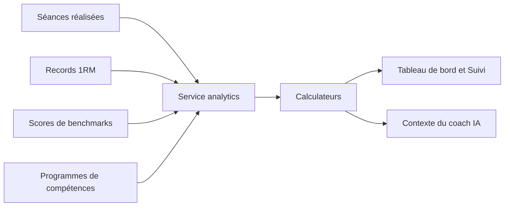

# Diagnostic de performance

Ce document décrit comment Training Camp mesure la progression d'un athlète.

## Principe

- Le diagnostic est **calculé, sans IA**. Les chiffres sont reproductibles et vérifiables.
- Il est affiché sur le tableau de bord et dans l'onglet « Diagnostic » de la page Suivi.
- Il est aussi transmis au coach IA, qui s'appuie dessus sans jamais le recalculer.
- **Règle métier** : un benchmark ne se compare qu'à lui-même. On ne compare jamais deux WOD différents parce qu'ils ont le même format.

## Comment ça fonctionne

Le service lit les données de l'athlète sur la période choisie (3 mois par défaut, de 1 à 12). Il les confie à des calculateurs indépendants. Le résultat alimente l'écran et le contexte de l'IA.

## Les indicateurs

| Indicateur | Question à laquelle il répond | Données nécessaires |
|---|---|---|
| **Ratios de force** | Mes lifts sont-ils équilibrés entre eux ? | 1RM |
| **Historique de force** | Mes 1RM progressent-ils ? | Historique des 1RM |
| **Progression par benchmark** | Suis-je meilleur sur Fran qu'avant ? | Scores de benchmarks |
| **Filières énergétiques** | Est-ce que je travaille toutes les durées d'effort ? | Chrono du metcon |
| **Volume et régularité** | Combien de séances par semaine, et avec quelle constance ? | Dates des séances |
| **Charge d'entraînement** | Est-ce que j'augmente la charge trop vite ? | RPE et durée totale de la séance |
| **Exposition par mouvement** | Quels mouvements je vois peu ou scale souvent ? | Résultats par exercice |
| **Avancement des compétences** | Où en suis-je dans mes programmes de skills ? | Étapes des programmes |

Un indicateur sans données n'est pas affiché. Les indicateurs **charge** et **exposition** restent vides tant que l'athlète ne saisit ni RPE ni résultats par exercice.

## Ratios de force

Fourchettes cibles indicatives. Elles varient selon le gabarit, l'âge et l'ancienneté.

| Ratio | Fourchette cible |
|---|---|
| Snatch / Clean & Jerk | 78 – 82 % |
| Front Squat / Back Squat | 82 – 88 % |
| Clean & Jerk / Back Squat | 70 – 75 % |
| Deadlift / Back Squat | 120 – 130 % |
| Overhead Squat / Back Squat | 60 – 70 % |

Chaque écart est accompagné d'une interprétation de coach : cause probable et piste de travail.

### 1RM estimés

Un 1RM est **réel** (testé) ou **estimé** (calculé depuis une série de plusieurs reps), au choix de l'athlète sur la page des 1RM. Une estimation peut se tromper d'environ 5 %.

- Un ratio qui repose sur au moins un 1RM estimé est signalé « estimé », à l'écran comme pour le coach IA : le déséquilibre est à confirmer par un test.
- Dans l'historique, le gain et la tendance ne comparent que des relevés de **même nature que le 1RM actuel** : un vrai test avec le vrai test précédent, une estimation avec les estimations. Un 1RM estimé à 100 kg suivi d'un test à 97 kg n'est donc pas une perte de 3 kg.

## Progression par benchmark

- Une série = **un workout** (`workout_id`), comparé à lui-même. Deux workouts homonymes restent deux séries, et un même workout saisi « Fran » puis « fran » reste une seule série, affichée sous son nom le plus récent.
- Chaque série a un **type de score** : celui du barème quand le benchmark en a un (Fran au temps, Cindy aux rounds), sinon le plus fréquent. Un score d'un autre type en est exclu : on ne compare pas des secondes à des rounds.
- Pour un **AMRAP**, les reps supplémentaires comptent en fraction de round : « 15 rounds + 14 » sur Cindy (30 reps par round) vaut 15,47. Sans barème, la taille d'un round est inconnue et l'app retient 100 reps par round, comme pour le calcul du niveau.
- **Variation** = premier test contre le dernier. Sous 3 %, la tendance reste stable : c'est la variation normale d'un test à l'autre (sommeil, fatigue, échauffement).

## Filières énergétiques

| Domaine | Durée d'effort |
|---|---|
| Puissance | moins de 3 min |
| Glycolytique | 3 à 8 min |
| Mixte | 8 à 15 min |
| Aérobie | 15 à 30 min |
| Aérobie long | plus de 30 min |

Un domaine sous 10 % des séances est signalé comme délaissé. Ce signal n'apparaît qu'à partir de 8 séances chronométrées.

La durée utilisée est celle du **metcon** (le chrono saisi), pas celle de la séance : un WOD de 12 min dans une séance d'une heure reste un effort mixte.

## Volume et régularité

- **Régularité** = semaines avec au moins une séance / toutes les semaines de la fenêtre.
- La fenêtre commence au début de la période choisie, ou à la première séance enregistrée si elle est plus récente : un athlète qui débute dans l'app n'est pas pénalisé pour les semaines d'avant.
- Elle se termine à la semaine en cours, comptée seulement si elle porte déjà une séance. Un lundi matin, rien n'a encore été manqué.
- Les semaines sans séance apparaissent à zéro sur le graphe : une coupure doit se voir.
- Les semaines vont du lundi au dimanche, **à l'heure de Paris**, quel que soit le fuseau du serveur : une séance le lundi à 0 h 30 compte dans la nouvelle semaine.

## Charge d'entraînement (sRPE et ACWR)

- **sRPE** (session RPE) = effort ressenti sur toute la séance × **durée totale de la séance** en minutes, échauffement compris. La durée est saisie à l'enregistrement de la séance. À défaut, l'app prend la durée de l'activité .fit, puis 60 minutes. Le chrono du metcon n'est jamais utilisé : il diviserait la charge d'une séance complète.
- **Variation hebdomadaire** = dernière semaine complète comparée à celle d'avant. La semaine en cours, inachevée, n'est pas comparée. Une semaine sans séance compte zéro ; si la semaine de référence est vide, aucune variation n'est affichée. Au-delà de +10 %, l'écran signale une hausse rapide.
- **ACWR** (Acute:Chronic Workload Ratio) = charge des 7 derniers jours / moyenne hebdomadaire des 28 derniers jours.
- L'ACWR n'est calculé que si la fenêtre des 28 jours est réellement remplie. Sinon, il n'est pas affiché :
  - la plus ancienne séance avec RPE date d'au moins 28 jours ;
  - au moins 3 des 4 tranches de 7 jours (comptées depuis aujourd'hui) contiennent une séance avec RPE ;
  - au moins 75 % des séances des 28 jours portent un RPE.
- Sans ces conditions, une séance ancienne isolée suivie d'une reprise afficherait un ratio de 4, son maximum, sans hausse de charge réelle.

| ACWR | Zone |
|---|---|
| moins de 0,8 | Charge basse, marge pour monter |
| 0,8 à 1,3 | Zone optimale |
| 1,3 à 1,5 | Vigilance |
| plus de 1,5 | Hausse rapide : stabiliser, ne plus augmenter |

Un ratio élevé signale une hausse de charge plus rapide que l'habitude. Ce n'est pas un diagnostic de blessure.

## Exposition par mouvement

- **Une exposition = une séance** où le mouvement apparaît. Un Thruster travaillé en force puis repris dans le metcon de la même séance compte une fois.
- Une séance compte comme **scalée** si le mouvement l'a été dans au moins une de ses sections.
- **Charges** : la charge moyenne, la charge max et le % du 1RM viennent des sections de **force** quand le mouvement y figure, sinon de ses sections de **metcon**. Les deux ne se mélangent jamais, et l'écran indique l'origine. Les charges d'échauffement, d'accessoires et de skill ne comptent pas.
- **Rapprochement avec les 1RM** : les noms courants et français sont reliés au lift (Clean & Jerk, C&J, Épaulé-jeté → Clean & Jerk ; Squat Clean → Clean ; Arraché → Snatch…), et regroupés en un seul mouvement. Les Power Clean et Power Snatch ne sont **pas** rapportés au 1RM de la version complète : ils en valent environ 80 à 85 %.

## Autres seuils

| Règle | Valeur |
|---|---|
| Tendance d'un benchmark | stable si la variation reste sous 3 % |
| Tendance d'un 1RM | stable si la variation reste sous 0,5 kg |
| Mouvement « souvent scalé » | au moins 3 séances et au moins 50 % d'entre elles scalées |
| Étape de compétence franchie | statut `completed` ou `skipped` |

> **Détail technique**
>
> - Endpoint : `GET /api/analytics/overview?months=3`, protégé par `JwtAuthGuard`.
> - `analytics.service.ts` fait les requêtes Knex. Les calculateurs de `analytics/calculators/` font les maths.
> - Les calculateurs sont des **fonctions pures** : testez-les directement, sans mock de Knex.
> - Le service est couvert par `analytics.service.spec.ts` (filtre `user_id` de chaque requête, lecture des séances), avec un faux query builder.
> - Table d'alias mouvement → lift : `calculators/lift-aliases.ts`, typée sur `ONE_REP_MAX_LIFTS`.
> - La date de référence (`now`) est injectable, pour des tests déterministes.
> - La synthèse transmise à l'IA est construite par `UserContextService`, puis formatée par `common/ai/diagnostic-prompt.ts`.
