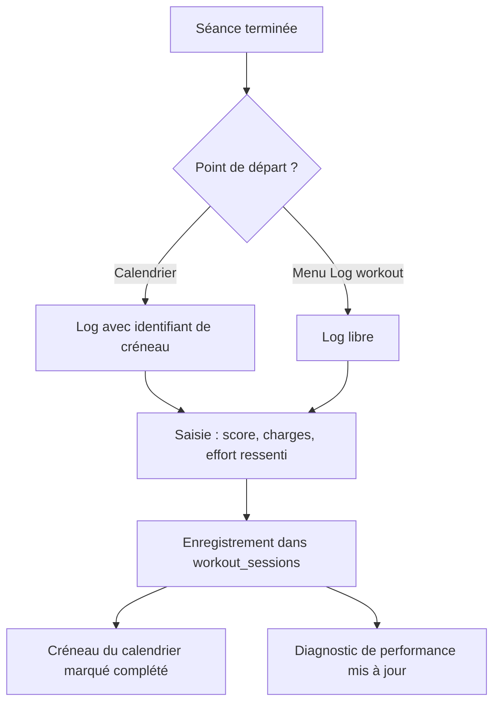

# Enregistrement d'une séance réalisée (log)

Ce document explique comment un athlète enregistre le résultat d'une séance. Il s'adresse aux Product Owners et aux développeurs qui touchent à la saisie ou au calendrier.

## Principe

- **Une seule page de log** : `/crossfit/log-workout`. Il n'y a pas de fenêtre modale.
- **Une seule table** : chaque séance réalisée est stockée dans `workout_sessions`.
- **La force n'est pas un module séparé** : c'est une section de type `strength` dans une séance CrossFit.
- **Les compétences (skills)** ont leur propre journal de progression, distinct du log de WOD.

## Parcours de l'athlète

Depuis le calendrier, le lien vers la page de log transporte l'identifiant du créneau (`scheduleId`). Après l'enregistrement, ce créneau passe au statut « complété ». Le diagnostic de performance relit ensuite les séances pour recalculer les indicateurs.

## Ce que l'athlète saisit

| Donnée | Utilité |
|---|---|
| **Score du WOD** | Temps, rounds ou répétitions, ou cap atteint avec le travail partiel |
| **Résultat par exercice** | Charge, répétitions, séries, version adaptée (scaled) ou non |
| **Effort ressenti (RPE)** | Échelle de 1 à 10. Croisé avec la durée, il mesure la charge d'entraînement |
| **Appréciation et notes** | Note de 1 à 5 et commentaire libre |
| **Fichier de montre (FIT)** | Pré-remplit durée, distance et zones de fréquence cardiaque |

Avec **un seul** fichier `.fit`, sa durée pré-remplit le chrono du WOD. Avec **plusieurs** fichiers, le chrono reste vide : la page propose « Total des fichiers » (simulation Hyrox enregistrée segment par segment) ou « Dernier fichier » (séance à modules dont seul le metcon final porte le score), ou une saisie manuelle. Additionner les fichiers d'une séance à modules classerait le metcon dans la mauvaise filière.

Sans RPE ni résultats par exercice, certains indicateurs du diagnostic restent vides. C'est attendu, pas un bug.

### Diagnostic de course : endurance

Le diagnostic affiche le **temps réellement mesuré en zone 2 par semaine** sur les courses continues
d'au moins 20 minutes. Fractionnés, formats à stations, allures inexploitables (notamment un relais
dont la durée inclut les pauses) et imports sans FC max du **profil** sont exclus. Il faut au moins
80 % de couverture cardiaque ; une semaine sans course exploitable est signalée, pas présentée comme
une mesure de zéro minute. La semaine en cours est partielle.

Les zones restent celles de l'import, en pourcentage de FC max : Z2 correspond à environ 60–70 %.
La FC de repos ne modifie pas ces zones. Une estimation par l'âge ou la FC max de la séance ne suffit
pas pour les nouveaux indicateurs d'endurance ; les anciennes zones ne sont jamais recalculées.

L'**allure à FC comparable** ne retient que les sorties dont la FC moyenne est en Z2 et dont au moins
70 % du temps mesuré est en Z1/Z2. Chaque sortie est comparée à la précédente éligible à ±3 bpm,
du même sport, avec la même FC max de référence, sur un autre jour. Sans paire comparable, aucune
tendance n'est annoncée. Cet indice descriptif n'est ni une mesure d'allure exclusivement en Z2,
ni une preuve de progression physiologique : terrain, chaleur et fatigue peuvent le modifier.

Les nouveaux indicateurs utilisent la date de départ de l'activité FIT, ou celle de la séance si
elle est absente. Les fractions déjà présentes dans le diagnostic restent séparées ; les notes
libres ne sont pas interprétées automatiquement comme un test 5 km.

## Compétences (skills)

Le travail technique suit un circuit à part :

- La planification passe par la table `scheduled_activities` (type `skill`).
- La progression se note depuis la page du programme (`/skills/[id]`), dans `skill_progress_logs`.

> **Détail technique — enregistrement**
>
> La page appelle une seule fois `sessionService.startSession()` avec `started_at`,
> `completed_at`, `notes`, `results` et, depuis le calendrier, `schedule_id`.
>
> Le serveur valide les dates, les résultats et les références avant écriture. La séance,
> son éventuelle mesure benchmark et la complétion du créneau sont enregistrées dans la
> même transaction : un échec ne laisse pas de séance partielle. Le créneau doit appartenir
> à l'athlète et correspondre au workout ; un jour Box sans workout précis accepte celui réellement fait.
> Supprimer la séance remet son créneau au statut « scheduled ».
>
> Une session peut référencer un `workout_id` visible (catalogue) ou un `personalized_workout_id`
> appartenant à l'athlète, jamais les deux. Le log libre sans référence reste possible pour
> les usages historiques. Les appels séparés démarrer/compléter restent compatibles pour les autres clients.

> **Historique des benchmarks**
>
> Les nouvelles mesures issues du log sont liées par `benchmark_history.session_id` :
> corriger le score met à jour la mesure, à la date `completed_at`, et supprimer la séance
> retire cette mesure. Les anciennes mesures sans lien certain restent intactes.
> Un workout utilisé par une séance, une mesure ou un créneau ne peut plus être supprimé
> (409) : il peut être archivé sans perdre les données associées.

> **Détail technique — contrat du champ `results`**
>
> `results` est un `jsonb` validé par `SessionResultsSchema` (Zod, dans `workout-sessions/schemas/`).
>
> | Champ | Type | Remarque |
> |---|---|---|
> | `elapsed_time_seconds`, `rounds`, `reps` | entier | Score du conditionnement |
> | `cap_reached`, `rounds_completed`, `partial_note` | divers | Cas du time cap atteint |
> | `rating` | 1 à 5 | Appréciation |
> | `rpe` | 1 à 10 | Échelle CR-10, sur toute la séance |
> | `session_duration_minutes` | 1 à 300 | Durée de la séance entière, échauffement compris. Pondère le RPE (sRPE) — à ne pas confondre avec `elapsed_time_seconds`, le chrono du metcon |
> | `exercise_results` | tableau | Une entrée **par exercice**, pas par série |
>
> Dans `exercise_results`, `load_kg` porte la charge la plus lourde travaillée.
>
> Le schéma utilise `.passthrough()`. Les anciennes clés (`coros`, `exercise_details`, `block_progress`…) sont donc conservées. `exercise_details` (texte libre) reste en lecture seule.
