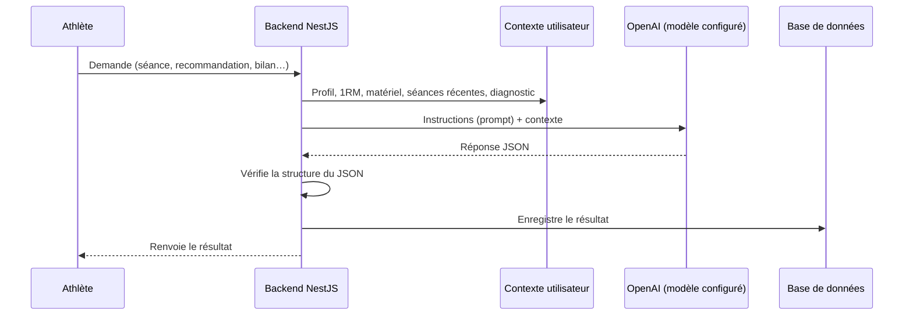

# Génération par intelligence artificielle

Ce document présente les services qui font appel à l'IA dans Training Camp. Il s'adresse aux Product Owners qui veulent comprendre le rôle du coach IA, et aux développeurs qui ajoutent ou modifient un service IA.

## Rôle de l'IA dans le produit

L'IA **rédige et propose**, elle ne **mesure** pas.

- Les chiffres (ratios de force, charge d'entraînement, progression) sont calculés sans IA par le module `analytics`.
- L'IA reçoit ces chiffres et s'en sert pour générer une séance, recommander quoi faire ou rédiger un bilan.
- Le prompt lui interdit de recalculer ou de contredire ces chiffres.

Ainsi, la séance générée, la recommandation et le bilan mensuel s'appuient tous sur les mêmes données.

## Comment ça fonctionne

Le backend enrichit chaque demande avec le profil complet de l'athlète. La réponse de l'IA est vérifiée avant d'être enregistrée. Un contenu mal formé n'atteint donc pas la base de données.

## Les services IA existants

| Service | Module | Ce qu'il produit |
|---|---|---|
| `AIWorkoutGeneratorService` | `workouts` | WOD personnalisé, WOD extrait d'un texte collé, WOD officiel retrouvé par son nom |
| `AISkillGeneratorService` | `skills` | Programme de progression vers une compétence (muscle-up, handstand…) |
| `WorkoutAnalysisService` | `workout-sessions` | Retour du coach après une séance terminée |
| `RecommendationsService` | `recommendations` | Recommandation de la prochaine séance (type, intensité, justification) |
| `DailySessionService` | `recommendations` | Transforme la recommandation en séance du jour planifiée |
| `TrackingService` | `tracking` | Bilan mensuel de progression |

## La séance du jour automatique

La carte « Séance du jour » du tableau de bord déclenche la création du WOD du jour. Le fonctionnement complet est décrit dans [Séance du jour et coach IA](seance-du-jour-coach.md).

Le bilan mensuel, lui, est vérifié à chaque connexion. Il n'est régénéré qu'une fois par mois calendaire.

## Contexte utilisateur partagé

**`UserContextService`** (exporté par `UserContextModule`, dans `backend/src/user-context/`) construit le contexte transmis à l'IA :

- niveau, objectifs, blessures, matériel disponible ;
- 1RM (records de force) ;
- séances et analyses récentes ;
- compétences en cours de progression ;
- synthèse du **diagnostic calculé** (champ `diagnostic`).

Le module importe uniquement `AnalyticsModule`. Ses consommateurs importent directement `UserContextModule`,
y compris pour `invalidateCache()` : ils partagent une seule instance du cache (TTL 30 min). Les types de
contexte sont dans `user-context/types/user-context.types.ts` et ceux du diagnostic destiné aux prompts dans
`common/ai/diagnostic.types.ts`, sans dépendance de `common/` vers `workouts/`.
`RecommendationsModule` et `WorkoutSessionsModule` conservent aussi `WorkoutsModule` pour leurs usages métier
réels (génération/planification et accès aux workouts), pas pour accéder au contexte.

Tout nouveau service IA doit injecter ce service.

### Profil sportif modifiable

L'onglet **Sport** de `/profile` permet de renseigner les objectifs, la durée habituelle de séance
(20 à 90 minutes, échauffement et retour au calme inclus), la fréquence souhaitée (1 à 7 séances/semaine),
les limitations fonctionnelles hors blessures, la date de naissance, le genre, la FC de repos habituelle
(30 à 120 bpm) et les jours disponibles. La FC max reste dans l'onglet **Profil** et continue d'alimenter
les zones cardiaques des imports. Ces informations sont facultatives ; une FC de repos isolée ne mesure
pas la récupération.

Les données sont enregistrées par `PATCH /api/users/me` dans les colonnes existantes, sans migration :

| Champ JSON | Contrat d'écriture |
|---|---|
| `global_goals` | Objet de booléens facultatifs : `weight_loss`, `muscle_gain`, `endurance`, `strength`, `flexibility`, `performance` |
| `training_preferences` | Objet : `preferred_duration` et `sessions_per_week`, entiers facultatifs |
| `physical_limitations` | Tableau historique de textes : au plus 10 limitations, 300 caractères chacune ; ne pas dupliquer les blessures |
| `schedule_preferences` | Objet : `available_days`, tableau sans doublon de jours anglais (`monday` à `sunday`) ; absent ou vide = aucune préférence |

Les clés inconnues, mauvais types et valeurs hors bornes sont rejetés (HTTP 400), y compris dans les JSON.
Une section JSON se remplace entièrement : `{}` ou `[]` l'efface. Pour `dateOfBirth` (date civile ISO, depuis
1900 et non future), `gender` (`male`, `female`, `other`) et `resting_heart_rate`, `null` efface la valeur.
Un champ omis n'est pas modifié ; le formulaire n'envoie que les champs modifiés.
Le brouillon Sport reste conservé lors des changements d'onglet du profil, y compris le texte des limitations ;
il est réinitialisé après une sauvegarde réussie, mais pas après un échec.
Les anciennes données ne sont pas migrées automatiquement. Les anciens objets de limitations restent lisibles ; les clés libres
historiques sont signalées dans le formulaire avant leur remplacement explicite.

Ces champs sont volontairement ajoutés à `PUBLIC_USER_COLUMNS`, accessible au propriétaire authentifié
sur `/users/me` uniquement. La date de naissance est sérialisée en date civile sans décalage de fuseau.
Le contexte partagé calcule l'âge à Paris et **ne transmet pas la date de naissance aux prompts**.
Les générations de WODs, programmes de compétences et recommandations reçoivent les préférences et
disponibilités, en plus des objectifs et limitations. Les jours sont **indicatifs** : aucun calendrier
n'est créé automatiquement. Les contraintes explicites de la demande et les restrictions liées aux blessures
priment. Les anciennes préférences mal formées sont ignorées avec un avertissement technique, sans réécriture.
Le cache du contexte IA est invalidé uniquement après une sauvegarde réussie. Les recommandations/séances du jour
déjà générées restent conservées selon leur contrat quotidien ; le nouveau profil s'applique aux générations suivantes.

> **Détail technique**
>
> Le client OpenAI est partagé via `OpenAIClientService` (`common/ai/`). Chaque appel utilise :
> - le modèle `OPENAI_MODEL` lu via `ConfigService`, avec son unique défaut défini par le schéma Joi (`common/config/env.validation.ts`) ;
> - une température envoyée seulement aux modèles gpt-4.x (`temperatureParam()`), car les modèles GPT-5+ la refusent ;
> - `response_format: { type: 'json_object' }` ;
> - un prompt système (règles, structure attendue) et un prompt utilisateur (contexte, demande).
>
> Une requête dure au plus 120 secondes, avec une seule nouvelle tentative en cas d'échec. Sans cette limite, le SDK attendrait jusqu'à 10 minutes par tentative.
>
> Le diagnostic est mis en forme par `buildDiagnosticPromptLines()` (`common/ai/diagnostic-prompt.ts`). Les blessures le sont par `formatInjuriesForPrompt()` (`common/injuries/`), qui ajoute les règles d'adaptation propres à chaque statut (active, en reprise, antécédent).
>
> | Erreur | Cause | Réponse HTTP |
> |---|---|---|
> | JSON invalide | L'IA n'a pas renvoyé de JSON exploitable | `400 BadRequestException` |
> | Échec de validation Zod | La structure ne respecte pas le schéma | `400` avec le détail des champs |
> | `{"error": "UNKNOWN_WOD"}` | L'IA ne connaît pas le WOD demandé avec certitude | `400 BadRequestException('UNKNOWN_WOD')` |
>
> Chaque service a son schéma Zod : `GeneratedWorkoutSchema`, `GeneratedSkillProgramSchema`, `WodAnalysisSchema`, `AIRecommendationSchema` et `AIProgressionReportSchema`.
>
> **Exception** : `WorkoutAnalysisService` renvoie une erreur `500` (et non `400`) quand la réponse de l'IA est invalide.

## Limite de connaissance de GPT-4.1

GPT-4.1 ne connaît pas les WOD du CrossFit Open postérieurs à début 2025.

L'endpoint `POST /workouts/lookup` accepte donc un champ `referenceData`. Il contient le texte exact du WOD, injecté dans le prompt au lieu d'être demandé à l'IA.

## Sécurité et coûts

- Toutes les routes IA exigent une authentification (`JwtAuthGuard`).
- Les routes de génération sont limitées à 10 requêtes par minute (voir [Authentification et sécurité](auth-securite.md)).
