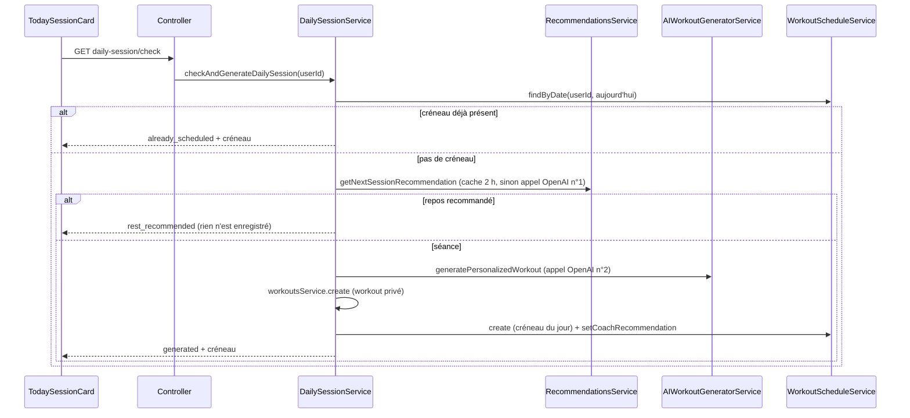

# Revue du module `recommendations`

Revue sécurité et qualité du module `backend/src/recommendations/` et de ses usages côté frontend (issue #49). Aucun code n'a été modifié : ce document décrit l'état au moment de la revue et propose des issues.

## 1. Rôle du module

Le module répond à une question : **« quelle séance l'athlète doit-il faire aujourd'hui ? »**

Il contient deux services :

| Service                  | Fichier                               | Rôle                                                                                                                                                                                                 |
| ------------------------ | ------------------------------------- | ---------------------------------------------------------------------------------------------------------------------------------------------------------------------------------------------------- |
| `RecommendationsService` | `services/recommendations.service.ts` | Demande à l'IA la recommandation du jour (type de séance, urgence, raison, durée). Résultat gardé 2 h en mémoire.                                                                                    |
| `DailySessionService`    | `services/daily-session.service.ts`   | Transforme la recommandation en WOD généré, l'enregistre dans `workouts` et le planifie dans `user_workout_schedule`. Gère aussi la « proposition du coach » quand le créneau du jour est déjà pris. |

Deux routes, toutes deux protégées par `JwtAuthGuard` et limitées à 10 requêtes par minute (`recommendations.controller.ts:7`, `:16`, `:26`) :

- `GET /api/recommendations/daily-session/check` : renvoie la séance du jour, en la générant si besoin.
- `POST /api/recommendations/daily-session/proposal` : génère (ou relit) le WOD que le coach aurait proposé.

Côté frontend, un seul consommateur : `frontend/app/(app)/dashboard/components/TodaySessionCard.tsx`, via `frontend/services/recommendations.ts`.

## 2. Flux principal

Coût d'une génération : deux appels OpenAI, l'un limité à 800 jetons (`recommendations.service.ts:33`), l'autre à 4096 (`workouts/services/ai-workout-generator.service.ts:293`).

## 3. Points forts

- **Appartenance des données correcte.** L'identifiant utilisateur vient toujours du jeton JWT (`req.user.id`), jamais du corps ou de l'URL. Toutes les requêtes du flux filtrent sur `user_id` : `findByDate` (`workout-schedule.service.ts:137`), `create` (`:185`), `setCoachRecommendation` et `setCoachProposal` (`:231`, `:243`, filtre `{ id, user_id }`). Un utilisateur ne peut pas lire ni modifier le créneau d'un autre.
- **Appel IA centralisé.** `createJsonCompletion` gère le modèle, le délai, la validation Zod (`AIRecommendationSchema`) et des erreurs génériques. Le `try/catch` de `checkAndGenerateDailySession` (`daily-session.service.ts:109-118`) journalise le détail mais ne renvoie au client que `reason: 'failed'` : aucune fuite de message d'erreur.
- **Concurrence prévue.** La contrainte unique `uq_user_date_schedule` (`database/migrations/20251118172321_create_user_workout_schedule_table.ts:37`) empêche deux créneaux le même jour, et le service renvoie le créneau existant en cas de conflit (`daily-session.service.ts:113-115`). Le frontend mutualise aussi les appels simultanés (`TodaySessionCard.tsx:226-234`).
- **Explication figée avec la séance.** La recommandation est copiée dans `coach_recommendation` : l'athlète voit toujours la raison de **cette** séance, même si le cache expire.
- **Proposition idempotente.** `generateProposal` renvoie la proposition déjà enregistrée sans rappeler l'IA (`daily-session.service.ts:137`).
- **Tests.** `daily-session.service.spec.ts` couvre 9 cas, dont le conflit concurrent et le jour de repos.

## 4. Problèmes déjà couverts par une issue ouverte

Ils ne sont pas repris plus bas.

| Sujet                                                     | Où                                                                                   | Issue                                                                          |
| --------------------------------------------------------- | ------------------------------------------------------------------------------------ | ------------------------------------------------------------------------------ |
| `GET daily-session/check` écrit en base et appelle l'IA   | `recommendations.controller.ts:15`                                                   | #54                                                                            |
| Bug de date UTC : « aujourd'hui » calculé en UTC          | `daily-session.service.ts:73` **et** `:132`, `recommendations.service.ts:65`         | #40 (l'issue compte 1 occurrence dans `daily-session.service.ts`, il y en a 2) |
| `RecommendationsModule` importe tout `WorkoutsModule`     | `recommendations.module.ts:8`                                                        | #32                                                                            |
| `@Request() req: { user: { id: string } }` typé à la main | `recommendations.controller.ts:17`, `:27`                                            | #31                                                                            |
| 3 fichiers non formatés Prettier                          | `recommendation.prompt.ts`, `recommendation.schema.ts`, `recommendations.service.ts` | #38 / #55                                                                      |

À noter pour #40 : `computeSessionStats` compare « aujourd'hui » (`recommendations.service.ts:65`) aux dates des séances fournies par `UserContextService` (`user-context.service.ts:232`), elles aussi en UTC. Aujourd'hui les deux côtés sont cohérents. Il faut les corriger **ensemble**, sinon `days_since_last` sera décalé d'un jour.

## 5. Problèmes classés par gravité

### Bugs

#### B1. Important : un jour de repos rappelle l'IA plusieurs fois et peut finir par générer une séance

- **Où** : `daily-session.service.ts:87-94`, `recommendations.service.ts:9-10` et `:18-21`.
- **Explication** : quand l'IA conseille du repos, rien n'est enregistré en base. Seul le cache mémoire de 2 h retient la décision. Donc :
  1. à chaque visite du dashboard après 2 h, un nouvel appel OpenAI est fait ;
  2. le cache est perdu à chaque redémarrage du backend, ce qui arrive souvent sur Render quand il se met en veille (voir `docs/seance-du-jour-coach.md:45`) ;
  3. le nouvel appel peut répondre « CrossFit » : l'athlète voit « Jour de repos » le matin, puis une séance générée l'après-midi.

  Le commentaire « Au plus un appel OpenAI par jour » (`daily-session.service.ts:66`) est donc faux les jours de repos. Même problème quand la génération échoue (`reason: 'failed'`) : chaque visite relance le générateur (4096 jetons).

- **Piste** : enregistrer la décision du jour en base. Par exemple une petite table `daily_recommendations (user_id, date, recommendation jsonb, outcome)` avec une contrainte unique `(user_id, date)`, lue avant tout appel IA. Pour l'échec, garder un compteur de tentatives par jour (par exemple 3 au maximum).
- **Terminé quand** :
  - [ ] Un jour de repos ne déclenche qu'un seul appel OpenAI, même après un redémarrage du backend
  - [ ] La décision « repos » ne change plus au cours de la journée
  - [ ] Le nombre de tentatives après un échec est borné
  - [ ] Tests unitaires pour ces trois cas

#### B2. Important : un workout orphelin reste en base quand la planification échoue

- **Où** : `daily-session.service.ts:96-101` (création du workout puis du créneau, sans transaction), `:109-117` (le `catch` ne supprime rien).
- **Explication** : le WOD est d'abord enregistré dans `workouts`, puis le créneau est créé. Si `scheduleService.create` échoue (conflit avec un appel concurrent, erreur base), le workout reste en base sans aucun créneau. Le test `daily-session.service.spec.ts:90-100` montre exactement ce cas : `workout-2` est créé, puis le conflit est absorbé, et personne ne le supprime. Avec B1 (nouvelles tentatives) et B3 (ces workouts sont visibles dans le catalogue), les orphelins s'accumulent sous les yeux des autres utilisateurs.
- **Piste** : faire `workoutsService.create` et `scheduleService.create` dans une même transaction Knex (`knex.transaction`), ou supprimer le workout dans le `catch` s'il a été créé. L'appel Google Calendar de `create` (`workout-schedule.service.ts:203-212`) doit rester hors transaction.
- **Terminé quand** :
  - [ ] Après un conflit de date, aucun workout n'est créé (ou il est supprimé)
  - [ ] Le test du cas concurrent vérifie l'absence d'orphelin

#### B3. Important : `recommended_type` et `suggested_duration` ne sont pas bornés

- **Où** : `schemas/recommendation.schema.ts:7` (`z.string().min(1)`) et `:11` (`z.number().int().positive()`) ; `prompts/recommendation.prompt.ts:35-36` ; `workouts/prompts/crossfit-generator.prompt.ts:701` et `:710`.
- **Explication** : le prompt liste six types (`technique_metcon`, `strength_max`, `conditioning`, `benchmark`, `vo2max`, `core`), mais le schéma Zod accepte n'importe quel texte. Si l'IA répond `"AMRAP"` ou `"active_recovery"` (cité ligne 36 pour le repos), le générateur reçoit un type inconnu : il l'injecte tel quel dans son prompt (`workoutTypeDescriptions[workoutType] || workoutType`) sans les consignes de structure. Cas particulier : `benchmark`. Le générateur n'a des consignes que si `benchmarkName` est fourni (`crossfit-generator.prompt.ts:710`), ce que `DailySessionService` ne fait jamais : l'IA invente donc un « benchmark ». De même, une durée de 5 ou 180 minutes passerait la validation. La doc (`docs/seance-du-jour-coach.md:36`, « Ex. AMRAP, EMOM, force + metcon ») ne correspond pas non plus aux valeurs attendues.
- **Piste** : `recommended_type: z.enum([...])` avec la liste des types réellement gérés par le générateur, en retirant `benchmark` (déjà planifié une fois par mois par `checkAndScheduleMonthlyBenchmark`) ; `suggested_duration: z.number().int().min(20).max(90)` ; corriger la doc.
- **Terminé quand** :
  - [ ] Une réponse IA avec un type ou une durée hors liste est rejetée par Zod (test du schéma)
  - [ ] Le prompt et la doc listent les mêmes types que le schéma

#### B4. Amélioration : le prompt ne donne pas la date du jour, et ses règles ne sont pas applicables

- **Où** : `prompts/recommendation.prompt.ts:24-32` (règles) et `:60-125` (prompt utilisateur) ; `services/recommendations.service.ts:47-82`.
- **Explication** :
  - Le prompt liste les séances récentes avec leur date (`:102`), mais jamais la date du jour. La règle « RPE 9-10 hier » (`:25`) oblige l'IA à deviner ce qu'est « hier ».
  - Les règles d'urgence parlent de « jours sans travail de force » ou « sans une modalité » (`:30-32`), mais `days_since_last` n'existe que par sport, donc seulement pour « crossfit » dans son ensemble. L'IA n'a aucun chiffre par modalité.
  - Les plages se chevauchent : « haute > 10 jours » et « moyenne 8-14 jours » couvrent toutes deux 11 à 14 jours.
- **Piste** : ajouter `Date du jour : <date> (<jour de la semaine>)` en tête du prompt utilisateur ; calculer dans `computeSessionStats` le nombre de jours depuis la dernière séance **par `workout_type`** et l'envoyer à la place de la répartition par sport ; corriger les plages d'urgence.
- **Terminé quand** :
  - [ ] Le prompt contient la date du jour et les jours écoulés par type de séance
  - [ ] Les plages d'urgence ne se chevauchent plus
  - [ ] Un test de `buildRecommendationUserPrompt` vérifie ces lignes

#### B5. Amélioration : `generateProposal` accepte un créneau déjà généré par le coach

- **Où** : `daily-session.service.ts:131-152` ; côté frontend, `TodaySessionCard.tsx:179`.
- **Explication** : la proposition n'a de sens que si le créneau vient de l'athlète. Le frontend cache le bouton quand `coach_recommendation` existe, mais le backend ne vérifie rien. Un appel direct à `POST /proposal` sur un créneau généré par le coach crée un second WOD presque identique, donc un appel OpenAI inutile et un workout de plus en base.
- **Piste** : dans `generateProposal`, lever une `ConflictException` (ou renvoyer la recommandation existante) si `schedule.coach_recommendation` est renseigné.
- **Terminé quand** :
  - [ ] `POST /proposal` sur un créneau généré automatiquement n'appelle pas l'IA (test unitaire)

### Sécurité

#### S1. Important : les WODs du coach, censés être privés, sont visibles par tous les utilisateurs

- **Où** : `daily-session.service.ts:154` (« workout privé ») et `:178-179` (`isPublic: false`, `status: 'published'`) ; le filtre de visibilité dans `workouts/services/workouts.service.ts:34` et `:38` ; `workouts/controllers/workouts.controller.ts:126-134`.
- **Explication** : le filtre de `findAll` est `isPublic = true OU isPublic IS NULL OU status = 'published' OU created_by_user_id = moi`. Un workout `published` est donc visible **même si `isPublic` vaut `false`**. Chaque séance du jour générée pour un athlète apparaît ainsi dans le catalogue des autres (`WorkoutsCatalogTable` sur `/workouts` et `/crossfit/workouts`, et la bibliothèque du calendrier `useWorkoutLibrary.ts:21-25`, qui filtre justement sur `status: 'published'`). Le WOD est construit à partir du profil (niveau, matériel, blessures via `formatInjuriesForPrompt`) : ses `coach_notes` peuvent révéler des informations de santé. Par ailleurs, `GET /workouts/:id` ne vérifie pas le propriétaire. Le même problème touche les WODs générés depuis `frontend/app/(app)/workouts/generate-ai/_hooks/useGenerateWorkout.ts:128-131` et `WodCaptureForm.tsx:94-95`.
- **Piste** : la cause est dans le module `workouts` (à traiter avec la revue #53). Filtre attendu : `isPublic IS NOT FALSE OU created_by_user_id = moi`, sans la condition sur `status`. Appliquer la même règle à `findOne`. Vérifier d'abord en base que les workouts du référentiel ont bien `isPublic = true` (la colonne vaut `true` par défaut, `20250923132051_create_workouts_table.ts:48`).
- **Terminé quand** :
  - [ ] Un workout `isPublic: false` d'un utilisateur A n'apparaît ni dans `GET /workouts` ni dans `GET /workouts/:id` pour un utilisateur B (test)
  - [ ] Les benchmarks et le référentiel restent visibles par tous

Le reste du module ne pose pas de problème de sécurité : routes gardées, limite de débit sur les deux routes IA, `userId` toujours issu du JWT, aucun DTO (rien à valider en entrée).

### Maintenabilité

#### M1. Amélioration : vestiges multi-sport et champs jamais lus

- **Où** :
  - `recommendations.service.ts:48` et `recommendation.prompt.ts:6-8`, `:87` : `ALL_SPORTS = ['crossfit']` et `SPORT_LABELS` dupliqués, boucles sur un seul sport ;
  - `recommendation.schema.ts:3` : `recommended_sport` sert seulement à dire « repos ou pas » ;
  - `recommendation.schema.ts:24-28` : `session_stats` et `generated_at` de `NextSessionRecommendation` ne sont lus nulle part (vérifié par recherche dans `backend/src` et `frontend`) ;
  - `recommendations.module.ts:11` : `RecommendationsService` et `DailySessionService` sont exportés, mais aucun autre module n'importe `RecommendationsModule` (seul `app.module.ts:56` le référence).
- **Piste** : supprimer les boucles multi-sport et les exports inutiles. `recommended_sport` peut rester pour ne pas casser le format de la réponse IA, mais renommer en `is_rest_day: boolean` serait plus clair (penser à mettre à jour le prompt et le frontend).
- **Terminé quand** :
  - [ ] Plus de `ALL_SPORTS` ni de `SPORT_LABELS` dans le module
  - [ ] `exports` retiré, `src/app.module.spec.ts` vert

#### M2. Amélioration : cache mémoire sans purge ni invalidation

- **Où** : `recommendations.service.ts:9-10` et `:43`.
- **Explication** : la `Map` garde une entrée par utilisateur pour toujours (les entrées expirées sont seulement écrasées, jamais supprimées). Le cache n'est pas non plus vidé quand l'athlète logge une séance, contrairement à celui de `UserContextService` (`invalidateCache`, appelé par `workout-sessions.service.ts:91`). Exemple : l'athlète logge une séance à 10 h, puis demande la proposition du coach à 11 h ; la proposition repose sur une recommandation calculée avant sa séance. Ce point disparaît si B1 est corrigé en base. Sinon, il faut une invalidation.
- **Piste** : si B1 crée une table, supprimer ce cache. Sinon, supprimer les entrées expirées à la lecture et exposer `invalidate(userId)`.
- **Terminé quand** :
  - [ ] Plus de cache mémoire non borné dans le module

#### M3. Amélioration : `RecommendationsService` n'a aucun test

- **Où** : seul `daily-session.service.spec.ts` existe.
- **Explication** : `computeSessionStats` (calcul de dates), le cache et `buildRecommendationUserPrompt` ne sont pas testés. Ce sont justement les parties que touchent #40, B1 et B4.
- **Piste** : un `recommendations.service.spec.ts` avec `UserContextService` et `OpenAIClientService` simulés (voir le skill `testing-knex-nestjs`), et un test des lignes produites par le prompt.
- **Terminé quand** :
  - [ ] Tests de `computeSessionStats` (aucune séance, séance du jour, séance d'il y a 3 jours), lancés avec `TZ=UTC` et `TZ=Europe/Paris`
  - [ ] Test du cache (deuxième appel sans OpenAI)

#### M4. Amélioration : types et commentaires approximatifs

- **Où** :
  - `recommendations.controller.ts:13` : « Appelé silencieusement à la connexion (voir AuthContext frontend) ». C'est faux : `AuthContext.tsx` ne l'appelle pas, c'est `TodaySessionCard` à l'affichage du dashboard (comme le dit d'ailleurs `docs/seance-du-jour-coach.md:49`).
  - `daily-session.service.ts:26` : `schedule: Record<string, unknown>`, d'où les conversions `schedule.id as string` (`:149`) et `schedule.coach_proposal as CoachProposal` (`:137`, sans validation du JSON lu en base).
  - Les types `CoachRecommendation`, `CoachProposal` et `DailySessionResult` sont recopiés à la main dans `frontend/services/recommendations.ts:5-27` : un changement côté backend ne sera pas détecté.
- **Piste** : corriger le commentaire ; typer le retour de `findByDate` (interface `ScheduleRow`) ; ajouter un commentaire « synchronisé avec `backend/src/recommendations/...` » sur les types frontend, en attendant un éventuel package de types partagé.
- **Terminé quand** :
  - [ ] Plus de `as string` / `as CoachProposal` dans `daily-session.service.ts`
  - [ ] Commentaire du contrôleur corrigé

#### M5. Amélioration : les consignes de l'IA passent pour des contraintes de l'athlète

- **Où** : `daily-session.service.ts:163` (`additionalInstructions: recommendation.suggested_instructions`) ; `workouts/prompts/crossfit-generator.prompt.ts` (bloc `CONTRAINTES DE L'ATHLÈTE (PRIORITAIRES)`, ligne 694).
- **Explication** : le texte `suggested_instructions` est écrit par la première IA, mais le générateur le présente comme « contraintes de l'athlète » qui « priment sur tout le reste ». Le générateur ne peut donc pas distinguer une vraie limite de l'athlète d'une simple idée du coach, et une idée du coach peut écraser la structure du type de séance.
- **Piste** : ajouter un paramètre distinct (`coachInstructions`) rendu sous un titre « Consignes du coach », non prioritaire.
- **Terminé quand** :
  - [ ] Le prompt du générateur sépare les consignes du coach des contraintes de l'athlète

## 6. Propositions d'issues

À créer par l'utilisateur (ces issues n'ont pas été créées).

| #   | Titre proposé                                                                                   | Points | Gravité      |
| --- | ----------------------------------------------------------------------------------------------- | ------ | ------------ |
| 1   | `[Workouts] Un workout privé (isPublic: false) est visible par les autres utilisateurs`         | S1     | Important    |
| 2   | `[Recommendations] Enregistrer la décision du jour pour ne plus rappeler l'IA un jour de repos` | B1, M2 | Important    |
| 3   | `[Recommendations] Ne pas laisser de workout orphelin quand la planification échoue`            | B2     | Important    |
| 4   | `[Recommendations] Restreindre recommended_type et suggested_duration aux valeurs gérées`       | B3     | Important    |
| 5   | `[Recommendations] Donner la date du jour et des stats par type de séance au prompt`            | B4     | Amélioration |
| 6   | `[Recommendations] Refuser la proposition du coach sur un créneau qu'il a déjà généré`          | B5     | Amélioration |
| 7   | `[Recommendations] Tests de RecommendationsService et du prompt`                                | M3     | Amélioration |
| 8   | `[Recommendations] Nettoyage : vestiges multi-sport, exports, types et commentaires`            | M1, M4 | Amélioration |
| 9   | `[IA] Séparer les consignes du coach des contraintes de l'athlète dans le générateur`           | M5     | Amélioration |

Ordre conseillé : 1 (fuite de données entre utilisateurs), puis 3 et 2 (2 et 3 touchent les mêmes lignes, à faire l'une après l'autre), puis 4. Corriger #40 en même temps que 2 évite de retoucher deux fois `daily-session.service.ts`.
