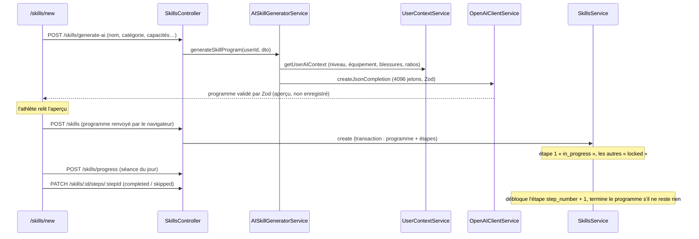

# Revue du module `skills`

Revue sécurité et qualité du module `backend/src/skills/` et de ses usages côté frontend (issue #50). Aucun code n'a été modifié : ce document décrit l'état au moment de la revue et propose des issues.

Sauf mention contraire, les chemins backend sont relatifs à `backend/src/skills/` et les chemins frontend à `frontend/`.

## 1. Rôle du module

Le module gère les **programmes de compétences** : un athlète veut apprendre un mouvement technique (muscle-up, handstand walk, squat snatch…). L'IA découpe l'objectif en étapes, l'athlète les franchit une par une et note ses séances de travail dans un journal.

Trois tables, chacune rattachée à la précédente :

| Table                 | Contenu                                               | Lien avec l'utilisateur                                   |
| --------------------- | ----------------------------------------------------- | --------------------------------------------------------- |
| `skill_programs`      | Le programme (nom, catégorie, statut, notes)          | `user_id` direct                                          |
| `skill_program_steps` | Les étapes (critère de validation, exercices, statut) | Indirect, via `program_id` → `skill_programs.user_id`     |
| `skill_progress_logs` | Le journal des séances (date, performance, notes)     | `user_id` direct **et** via `step_id` → étape → programme |

Le module contient :

| Fichier                                  | Rôle                                                                   |
| ---------------------------------------- | ---------------------------------------------------------------------- |
| `controllers/skills.controller.ts`       | 9 routes, toutes protégées par `JwtAuthGuard`                          |
| `services/skills.service.ts`             | CRUD des programmes, étapes et journaux, déblocage de l'étape suivante |
| `services/ai-skill-generator.service.ts` | Génère un programme avec OpenAI (aperçu, rien n'est enregistré)        |
| `prompts/skill-progression.prompt.ts`    | Prompts système et utilisateur                                         |
| `schemas/skill-program.schema.ts`        | Schéma Zod de la réponse de l'IA                                       |
| `dto/skill.dto.ts`                       | DTO class-validator des routes                                         |

Les programmes actifs sortent du module par deux chemins :

- `UserContextService` (`workouts/services/user-context.service.ts:213-240`) lit l'étape en cours de chaque programme actif. `AIWorkoutGeneratorService.buildSkillInstruction` (`workouts/services/ai-workout-generator.service.ts:145-185`) choisit le skill le moins récemment travaillé et ajoute un bloc `skill_work` au WOD généré.
- `scheduled_activities` (type `skill`) : une séance de compétence se planifie dans le calendrier, `activity_id` pointe vers `skill_programs.id` (`scheduled-activities/scheduled-activities.service.ts:44-83`).

Côté frontend : `services/skills.ts`, les pages `/skills`, `/skills/new`, `/skills/[id]`, `/crossfit/skills`, la carte `dashboard/components/SkillOfTheDayCard.tsx` et la modale `components/calendar/ScheduleSkillModal.tsx`.

## 2. Flux principal

Point clé pour la suite : **le programme enregistré n'est pas celui que l'IA a produit**, c'est celui que le navigateur renvoie à `POST /skills`. La validation Zod de l'étape 1 ne protège donc pas l'enregistrement de l'étape 2.

## 3. Points forts

- **Appartenance des données correcte partout.** L'identifiant utilisateur vient toujours du jeton (`req.user.id`), jamais du corps ou de l'URL. Chaque méthode vérifie que la ressource appartient à l'utilisateur avant d'agir :
  - programme : filtre `{ id, user_id }` dans `findOne` (`services/skills.service.ts:55`), `updateProgram` (`:105`, `:122`), `updateStep` (`:128`), `deleteProgram` (`:189`) ;
  - étape : `updateStep` cherche l'étape **dans** le programme vérifié (`:134`, filtre `program_id`) ; `logProgress` et `getStepLogs` font une jointure sur `skill_programs.user_id` (`:201-204`, `:226-229`) ;
  - journal : `deleteLog` filtre sur `user_id` (`:239`).
- **Le calendrier vérifie aussi l'appartenance.** `assertOwnsSkillProgram` (`scheduled-activities/scheduled-activities.service.ts:124-129`) refuse de planifier le programme d'un autre utilisateur, à la création comme à la modification (`:261-263`, `:301-303`), et l'enrichissement ne lit que les programmes de l'utilisateur (`:49`).
- **Appel IA conforme au pattern du projet.** `AISkillGeneratorService` passe par `createJsonCompletion` (modèle lu dans la config, délai, validation Zod, erreurs génériques), sans `try/catch` qui renverrait `error.message`. La route est limitée à 10 requêtes par minute (`controllers/skills.controller.ts:42`).
- **Prompt nourri par le contexte réel.** Blessures via `formatInjuriesForPrompt`, équipement du profil par défaut, et ratios de force injectés seulement en haltérophilie et en force (`prompts/skill-progression.prompt.ts:7`, `:183`). Ce dernier point est couvert par `prompts/skill-progression.prompt.spec.ts`.
- **Création atomique.** Programme et étapes sont insérés dans une seule transaction (`services/skills.service.ts:67-101`).
- **Contrainte d'unicité en base** sur `(program_id, step_number)` (`database/migrations/20260223100001_create_skill_program_steps_table.ts:20`) : deux étapes ne peuvent pas avoir le même numéro.

**Aucun point bloquant** n'a été trouvé : pas de fuite entre utilisateurs, guard présent sur toutes les routes, pas de détail d'erreur renvoyé au client.

## 4. Problèmes déjà couverts par une issue ouverte

Ils ne sont pas repris plus bas.

| Sujet                                                                  | Où                                            | Issue |
| ---------------------------------------------------------------------- | --------------------------------------------- | ----- |
| `@Request() req: { user: { id: string } }` typé à la main (9×)         | `controllers/skills.controller.ts:23` à `:88` | #31   |
| `SkillsModule` importe tout `WorkoutsModule` pour `UserContextService` | `skills.module.ts:2`, `:8`                    | #32   |
| Le type `RatioImbalance` vient de `workouts`                           | `prompts/skill-progression.prompt.ts:4`       | #35   |
| Statistiques de compétences dans le diagnostic                         | `analytics/analytics.service.ts:89-95`        | #52   |

À noter pour #40 : le module `skills` côté backend n'a **aucune** occurrence de `toISOString().slice(0, 10)`. En revanche, le frontend calcule « aujourd'hui » en UTC à deux endroits liés aux skills (voir I6). #40 ne liste que des fichiers backend : ce point est donc nouveau.

## 5. Problèmes classés par gravité

### Important

#### I1. `POST /skills` enregistre des étapes sans aucune validation

- **Où** : `dto/skill.dto.ts:53-65` (`steps` n'a que `@IsArray()`, `CreateSkillStepDto` n'a aucun décorateur), `:39-43` (`estimated_weeks` et `ai_parameters` n'ont que `@IsOptional()`) ; `services/skills.service.ts:83-96`.
- **Explication** : class-validator ne descend dans un objet imbriqué que s'il porte `@ValidateNested()` et `@Type(() => CreateSkillStepDto)`. Sans eux, chaque élément de `steps` est accepté tel quel : `whitelist` et `forbidNonWhitelisted` ne s'y appliquent pas non plus. Conséquences vérifiées dans le code :
  1. `step_number` ou `title` manquant, `step_number` en double, titre de plus de 255 caractères, `estimated_weeks` non numérique : l'erreur vient de PostgreSQL et le client reçoit un **500** (aucun filtre d'exception ne traduit ces erreurs).
  2. `steps: []` passe `@IsArray()`. Knex compile alors un `INSERT` vide et lève `The query is empty` (`node_modules/knex/lib/dialects/postgres/index.js:217`) : la transaction est annulée, le client reçoit un 500.
  3. `recommended_exercises` peut contenir n'importe quoi. Si c'est une chaîne non JSON (ex. `"abc"`), elle est stockée en `jsonb` puis relue par `UserContextService`, qui fait `JSON.parse(row.recommended_exercises)` (`workouts/services/user-context.service.ts:304`). `JSON.parse('abc')` lève une exception : **tous les appels IA qui lisent ce contexte** échouent pour cet utilisateur (génération de WOD et de programmes, séance du jour du coach, bilans de progression) tant que le programme est actif.

  Le risque reste limité à son propre compte (il faut appeler l'API à la main), mais une donnée corrompue bloque des fonctions sans rapport avec les skills.

- **Piste** : deux options.
  - Ajouter les décorateurs : `@ValidateNested({ each: true })`, `@Type(() => CreateSkillStepDto)`, `@ArrayMinSize(2)`, `@ArrayMaxSize(10)` sur `steps` ; `@IsInt()`, `@Min(1)`, `@IsString()`, `@MaxLength()` sur les champs de l'étape ; `@IsObject()` / `@IsArray()` sur les champs JSON.
  - Plus simple et plus sûr : valider le corps de `POST /skills` avec le **même** schéma Zod que la réponse de l'IA (`GeneratedSkillProgramSchema`). Une seule définition, et le contrôle de I2 s'applique automatiquement aux deux routes.

  Dans `UserContextService`, protéger le `JSON.parse` (ou ne garder que `Array.isArray`, puisque `pg` renvoie déjà le `jsonb` décodé).

- **Terminé quand** :
  - [ ] `POST /skills` avec une étape incomplète, un `step_number` en double ou `steps: []` répond 400
  - [ ] Un `recommended_exercises` invalide ne peut plus casser `getUserAIContext`
  - [ ] Tests unitaires du DTO ou du schéma pour ces cas

#### I2. Les numéros d'étape renvoyés par l'IA ne sont pas contrôlés

- **Où** : `schemas/skill-program.schema.ts:21` et `:40` ; `services/skills.service.ts:85` (le numéro est recopié tel quel), `:159-161` (déblocage de `step_number + 1`) ; `prompts/skill-progression.prompt.ts:124-125`.
- **Explication** :
  - Zod vérifie que chaque `step_number` est un entier positif, mais pas qu'ils sont **uniques et consécutifs**. Deux étapes numérotées 3 passent la validation, s'affichent dans l'aperçu, puis l'enregistrement échoue sur la contrainte `uq_skill_step_number` (500, message générique « Erreur lors de la sauvegarde »). L'athlète a payé une génération pour rien.
  - Si les numéros ont un trou (1, 2, 4…), terminer l'étape 2 cherche l'étape 3, ne la trouve pas, et **ne débloque rien** : le programme reste bloqué sans étape en cours.
  - `create` met l'étape à l'index 0 du tableau en `in_progress` (`:92`), pas l'étape numéro 1. Si l'IA renvoie les étapes dans le désordre, la mauvaise étape démarre.
  - Le prompt exige 4 à 10 étapes et au moins 2 exercices par étape, le schéma accepte 2 étapes minimum, sans maximum, et 1 exercice (`:25`, `:40`). La doc (`docs/programmes-competences.md:77`) décrit le schéma, pas le prompt.
- **Piste** : un `.superRefine()` sur `GeneratedSkillProgramSchema` qui vérifie que les numéros valent exactement 1..N ; `.min(4).max(10)` sur `steps`, `.min(2)` sur `recommended_exercises` (ou assouplir le prompt, mais les deux doivent dire la même chose). Côté service, trier par `step_number` avant d'insérer, ou renuméroter selon l'ordre du tableau. Avec I1 (même schéma pour `POST /skills`), la règle protège aussi l'enregistrement.
- **Terminé quand** :
  - [ ] Une réponse IA avec des numéros en double ou avec un trou est rejetée (test du schéma)
  - [ ] Prompt, schéma et doc annoncent le même nombre d'étapes et d'exercices

#### I3. Fréquence, moment et échauffement générés par l'IA sont perdus à l'enregistrement

- **Où** : `prompts/skill-progression.prompt.ts:111-121` et `:130` (l'IA doit **toujours** les fournir) ; `schemas/skill-program.schema.ts:28-30` ; `frontend/app/(app)/skills/new/page.tsx:328-339` (affichés dans l'aperçu) puis `:88-96` (absents de l'objet envoyé) ; `database/migrations/20260223100001_create_skill_program_steps_table.ts` (aucune colonne) ; `frontend/app/(app)/skills/[id]/_components/SkillStepCard.tsx:135-147` (affichage prévu, jamais alimenté).
- **Explication** : l'athlète voit « Fréquence : 3x par semaine », « Quand : avant le WOD » et l'échauffement dans l'aperçu. Une fois le programme enregistré, ces informations disparaissent : le frontend ne les envoie pas, le DTO ne les connaît pas, et la table n'a pas de colonne pour elles. Le bloc « Programming info » de `SkillStepCard` ne s'affiche donc jamais. La doc (`docs/programmes-competences.md:41-42`) les présente pourtant comme faisant partie d'une étape.
- **Piste** : migration qui ajoute `frequency`, `when_to_train` et `warmup` (`text`, nullable) à `skill_program_steps` ; les ajouter au DTO (ou au schéma Zod, voir I1), au service et à l'objet envoyé par `skills/new/page.tsx`. Les programmes existants resteront sans ces champs.
- **Terminé quand** :
  - [ ] Après enregistrement, la page `/skills/[id]` affiche la fréquence, le moment et l'échauffement de chaque étape
  - [ ] Migration avec `up` et `down`, testée en local

#### I4. Mettre un programme en pause ne prévient pas le coach IA (cache non invalidé)

- **Où** : `services/skills.service.ts:104-125` (`updateProgram`, aucun appel à `invalidateCache`) et `:238-247` (`deleteLog`, idem) ; `workouts/services/user-context.service.ts:137` (TTL de 30 min) et `:219` (seuls les programmes `active` sont lus).
- **Explication** : `create`, `updateStep`, `deleteProgram` et `logProgress` invalident le cache du contexte IA, mais pas `updateProgram`. Quand l'athlète met un programme en pause ou l'abandonne (`frontend/app/(app)/skills/[id]/_hooks/useSkillDetail.ts:112-132`), le générateur de WOD continue pendant 30 minutes d'ajouter un bloc `skill_work` pour ce skill. Inversement, reprendre un programme ne le fait pas apparaître tout de suite. Même chose pour `deleteLog` : la date de dernière séance (`last_trained`, qui décide du skill travaillé) reste celle du journal supprimé. La doc affirme le contraire : « Toute modification invalide le cache » (`docs/programmes-competences.md:79`).
- **Piste** : appeler `this.userContextService.invalidateCache(userId)` à la fin de `updateProgram` et de `deleteLog`.
- **Terminé quand** :
  - [ ] Test unitaire : `updateProgram` et `deleteLog` appellent `invalidateCache`
  - [ ] Juste après une mise en pause, un WOD généré ne contient plus le skill

#### I5. Les séances planifiées restent au calendrier après suppression ou fin du programme

- **Où** : `services/skills.service.ts:188-198` (`deleteProgram`) et `:104-125` (`updateProgram`) ; `database/migrations/20260408100000_create_scheduled_activities.ts:9-11` (`activity_id` sans clé étrangère, voir aussi `docs/calendrier-planification.md:76`) ; `scheduled-activities/scheduled-activities.service.ts:96` et `:233-239`.
- **Explication** : `scheduled_activities.activity_id` pointe vers `skill_programs.id` sans contrainte. Quand un programme est supprimé, ses séances planifiées restent. L'enrichissement ne trouve plus le programme : le calendrier affiche un créneau « Skill » sans nom ni étape, et le lien « Voir dans Progressions » renvoie vers `/skills` (`frontend/app/(app)/calendar/_components/CalendarEventModal.tsx:134`). Même chose, en moins grave, quand le programme est abandonné ou terminé : les séances futures continuent d'apparaître.

  À savoir : l'index unique `(user_id, scheduled_date, activity_type)` (`database/migrations/20261006122526_unique_scheduled_activity_per_day.ts`) n'autorise qu'**un** skill par jour, même avec deux programmes actifs. C'est un choix à confirmer, pas un bug.

- **Piste** : dans `deleteProgram`, et dans `updateProgram` quand le statut passe à `abandoned` ou `completed`, supprimer (dans la même transaction) les `scheduled_activities` de type `skill`, liées à ce programme, encore au statut `scheduled` et datées d'aujourd'hui ou après. Les séances passées restent comme historique. Une clé étrangère n'est pas possible (`activity_id` est polymorphe).
- **Terminé quand** :
  - [ ] Supprimer ou abandonner un programme retire ses séances futures du calendrier
  - [ ] Les séances passées sont conservées
  - [ ] Tests unitaires du service

#### I6. Deux journaux qui s'ignorent : calendrier et progression

- **Où** : `frontend/app/(app)/calendar/_components/CalendarEventModal.tsx:88-97` (bouton « Terminer » d'un skill) → `frontend/app/(app)/calendar/_hooks/useWorkoutSchedule.ts:89-90` (met seulement le créneau à `completed`) ; `services/skills.service.ts:200-223` (`logProgress` ne touche pas au calendrier) ; `workouts/services/user-context.service.ts:217` et `:229` (`last_trained` = date max de `skill_progress_logs`).
- **Explication** : un athlète qui termine sa séance de skill depuis le calendrier n'écrit **rien** dans `skill_progress_logs`. Pour le coach IA, ce skill n'a jamais été travaillé (`last_trained` reste vide) et il est donc choisi en priorité au prochain WOD (`workouts/services/ai-workout-generator.service.ts:148-153`). À l'inverse, noter une séance sur `/skills/[id]` laisse le créneau du jour « planifié ». Les deux vérités divergent.
- **Piste** : choisir une source de vérité. Le plus simple : le bouton « Terminer » du calendrier ouvre la saisie de séance de l'étape en cours (comme « Logger le workout » pour le CrossFit, `CalendarEventModal.tsx:108-124`), et `logProgress` marque `completed` le créneau `skill` du même jour lié à ce programme, s'il existe.
- **Terminé quand** :
  - [ ] Terminer une séance de skill depuis le calendrier crée une entrée dans le journal de l'étape en cours
  - [ ] Noter une séance depuis `/skills/[id]` passe le créneau du jour à « terminé »

#### I7. Bug de date : « aujourd'hui » calculé en UTC, `session_date` non validée

- **Où** : `frontend/app/(app)/skills/[id]/_hooks/useSkillDetail.ts:146` et `frontend/app/(app)/dashboard/components/SkillOfTheDayCard.tsx:67` (`new Date().toISOString().split('T')[0]`) ; `dto/skill.dto.ts:90-91` (`@IsString()`) ; `services/skills.service.ts:235` (`session_date` renvoyée telle que lue par `pg`).
- **Explication** :
  - `toISOString()` donne la date **UTC**. Entre minuit et 1 h (2 h en été) à Paris, c'est encore la veille en UTC : une séance notée à 0 h 30 depuis le dashboard est enregistrée la veille. C'est le même bug que #40, mais côté frontend, que #40 ne couvre pas.
  - `session_date` n'est vérifiée que comme chaîne : `"demain"` ou `"2026-13-45"` arrivent jusqu'à PostgreSQL, qui renvoie une erreur (500). Une date dans le futur est acceptée.
  - `session_date` est une colonne `date`. `pg` la renvoie en `Date` à minuit heure du serveur, sérialisée en ISO avec fuseau. Le frontend la relit avec `new Date(...)` (`SkillStepCard.tsx:209`, `useSkillDetail.ts:212`). Pour un navigateur à Paris le jour affiché est bon, mais le contrat de l'API est fragile.
- **Piste** : côté frontend, `format(new Date(), 'yyyy-MM-dd')` de `date-fns` (déjà utilisé dans `app/(app)/calendar/_hooks/useCalendarPage.ts`). Côté DTO, `@IsDateString({ strict: true })` et un refus des dates futures. Côté service, renvoyer `toDateOnly(log.session_date)` (`common/utils/date-only.ts`) dans `getStepLogs` et `logProgress`.
- **Terminé quand** :
  - [ ] Une séance notée à 0 h 30 heure de Paris est datée du bon jour
  - [ ] `POST /skills/progress` avec une date invalide répond 400
  - [ ] L'API renvoie `session_date` au format `AAAA-MM-JJ`

### Amélioration

#### A1. Un identifiant non UUID dans l'URL donne une erreur 500

- **Où** : `controllers/skills.controller.ts:30`, `:36`, `:62-63`, `:73`, `:82`, `:88`.
- **Explication** : `GET /skills/abc` envoie `abc` à PostgreSQL, qui refuse de le comparer à une colonne `uuid` (`invalid input syntax for type uuid`). Sans filtre d'exception, le client reçoit 500. Les modules `equipments` et `scheduled-activities` utilisent déjà `ParseUUIDPipe` pour ce cas (`equipments/equipments.controller.ts:22-23`).
- **Piste** : `@Param('id', ParseUUIDPipe)` sur tous les paramètres (`id`, `stepId`, `logId`).
- **Terminé quand** :
  - [ ] Chaque route répond 400 à un identifiant non UUID (test du contrôleur)

#### A2. Entrées de la génération IA sans limite de taille

- **Où** : `dto/skill.dto.ts:4-25` (`skillName`, `currentCapabilities`, `constraints`, `availableEquipment`) ; `services/ai-skill-generator.service.ts:38` (`maxOutputTokens: 4096`).
- **Explication** : aucun `@MaxLength` ni `@ArrayMaxSize`. Le seul plafond est la taille maximale du corps JSON d'Express (100 Ko par défaut, `main.ts` ne la change pas). Un appel peut donc envoyer environ 100 Ko de texte dans le prompt, 10 fois par minute : coût OpenAI inutile. Les autres DTO du projet bornent leurs textes (`users/dto/users.dto.ts:50`, `scheduled-activities/dto/scheduled-activity.dto.ts:22`).

  Hypothèse à vérifier dans les logs (non mesurée pendant la revue) : avec 10 étapes et tous les champs demandés, la réponse peut approcher 4096 jetons. Une réponse coupée n'est plus du JSON valide et finit en 502.

- **Piste** : `@MaxLength(100)` sur `skillName`, `@MaxLength(1000)` sur les textes libres, `@ArrayMaxSize(50)` et `@MaxLength(100, { each: true })` sur `availableEquipment`. Surveiller les 502 « programme de compétence » avant de relever `maxOutputTokens`.
- **Terminé quand** :
  - [ ] Un texte trop long est refusé avec un 400 (test du DTO)

#### A3. `updateStep` : transitions libres et écritures hors transaction

- **Où** : `services/skills.service.ts:127-186` ; `dto/skill.dto.ts:77-84`.
- **Explication** :
  - N'importe quelle transition est acceptée : passer une étape `locked` à `completed`, remettre une étape terminée à `in_progress`, ou avoir plusieurs étapes `in_progress` (le contexte IA les lirait toutes, `user-context.service.ts:214-216`). Le frontend n'envoie que `completed` et `skipped` sur l'étape en cours, mais l'API ne l'impose pas.
  - Jusqu'à quatre écritures se suivent (étape, étape suivante, programme) sans transaction : une erreur au milieu laisse un état partiel.
  - Revenir en arrière ne rouvre pas un programme déjà terminé automatiquement.
  - `manually_overridden` n'a pas de `@IsBoolean()`, et n'est pris en compte que si `status` est aussi envoyé (`:144`).
- **Piste** : n'accepter `completed` / `skipped` que sur l'étape `in_progress` (sinon 409), envelopper les écritures dans `knex.transaction`, ajouter `@IsBoolean()`.
- **Terminé quand** :
  - [ ] Valider une étape verrouillée répond 409
  - [ ] Les écritures de `updateStep` sont dans une transaction
  - [ ] Tests unitaires du déblocage et de la fin de programme

#### A4. Les critères « distance » et « pas » sont enregistrés comme une note de qualité

- **Où** : `frontend/app/(app)/skills/[id]/_hooks/useSkillDetail.ts:158-166` et `:210` ; `frontend/app/(app)/dashboard/components/SkillOfTheDayCard.tsx:59-63` et `:11-16`.
- **Explication** : le schéma accepte six types de critère (`schemas/skill-program.schema.ts:4`), mais la saisie n'en gère que trois. Pour `distance` et `steps`, la valeur part dans `quality_score`. Le graphique la lit quand même, mais les données sont mal nommées et inexploitables plus tard (analyse, diagnostic). La même logique est recopiée dans deux fichiers.
- **Piste** : une fonction partagée (par exemple dans `frontend/domain/` ou `services/skills.ts`) qui associe chaque type de critère à son champ (`distance_m`, `steps_count`), utilisée par les deux écrans.
- **Terminé quand** :
  - [ ] Une séance sur un critère `distance` enregistre `distance_m`
  - [ ] Une seule implémentation de la correspondance type → champ

#### A5. Aucun test pour les services et le contrôleur

- **Où** : seul `prompts/skill-progression.prompt.spec.ts` existe dans le module.
- **Explication** : la logique la plus délicate (déblocage de l'étape suivante, fin automatique du programme, vérifications d'appartenance, invalidation du cache) n'est pas testée. Les corrections I1 à I5 et A3 la toucheront.
- **Piste** : `services/skills.service.spec.ts` avec le skill `testing-knex-nestjs` (mock du query builder), `services/ai-skill-generator.service.spec.ts` (mock d'`OpenAIClientService`, vérifier que l'équipement du profil sert de valeur par défaut), test du contrôleur pour les pipes. Relancer `src/app.module.spec.ts` après tout changement d'imports.
- **Terminé quand** :
  - [ ] Tests de `updateStep` (déblocage, dernière étape, étape introuvable), `logProgress` et `deleteProgram` (appartenance)
  - [ ] Test de `AISkillGeneratorService`

#### A6. Nettoyage

- **Où et quoi** :
  - Code mort : `frontend/app/(app)/skills/[id]/_components/WodGenerationModal.tsx` n'est importé nulle part, et le type `WodModalState` (`useSkillDetail.ts:13-34`) n'existe que pour lui.
  - Messages d'erreur sans accents : « Programme de skill non trouve », « Etape non trouvee », « Log non trouve » (`services/skills.service.ts`, 8 occurrences). `scheduled-activities` écrit « Programme de skill non trouvé ».
  - `findAll` fait deux requêtes de comptage (`:31-42`) là où une seule suffirait (`count(*) FILTER (WHERE status IN (...))`).
  - `GET /skills?status=` n'est pas validé (`controllers/skills.controller.ts:23`) : une valeur inconnue renvoie une liste vide au lieu d'un 400.
- **Terminé quand** :
  - [ ] Composant et type morts supprimés, messages accentués, `status` validé par un DTO de requête

## 6. Propositions d'issues

À créer par l'utilisateur (ces issues n'ont pas été créées).

| #   | Titre proposé                                                                         | Points | Gravité      |
| --- | ------------------------------------------------------------------------------------- | ------ | ------------ |
| 1   | `[Skills] Valider les étapes de POST /skills avec le schéma Zod du programme`         | I1     | Important    |
| 2   | `[Skills] Contrôler les numéros et le nombre d'étapes renvoyés par l'IA`              | I2     | Important    |
| 3   | `[Skills] Enregistrer la fréquence, le moment et l'échauffement de chaque étape`      | I3     | Important    |
| 4   | `[Skills] Invalider le cache du contexte IA dans updateProgram et deleteLog`          | I4     | Important    |
| 5   | `[Skills] Retirer du calendrier les séances d'un programme supprimé ou abandonné`     | I5     | Important    |
| 6   | `[Skills] Relier le « Terminer » du calendrier au journal de progression`             | I6     | Important    |
| 7   | `[Skills] Dater les séances au jour de Paris et valider session_date`                 | I7     | Important    |
| 8   | `[Skills] ParseUUIDPipe et limites de taille sur les entrées de la génération IA`     | A1, A2 | Amélioration |
| 9   | `[Skills] Transitions d'étape contrôlées et transaction dans updateStep`              | A3     | Amélioration |
| 10  | `[Skills] Enregistrer chaque type de critère dans son propre champ`                   | A4     | Amélioration |
| 11  | `[Skills] Tests unitaires de SkillsService, AISkillGeneratorService et du contrôleur` | A5     | Amélioration |
| 12  | `[Skills] Nettoyage : WodGenerationModal mort, messages, comptages, filtre status`    | A6     | Amélioration |

Ordre conseillé :

1. **4** d'abord : deux lignes, effet immédiat sur les WOD générés.
2. **1 puis 2** : elles modifient le même schéma, 2 profite directement de 1.
3. **3** : la migration est simple, et le schéma Zod de 1 contient déjà les trois champs.
4. **7**, puis **5 et 6** ensemble (elles touchent toutes les deux le lien avec `scheduled_activities`).
5. **11** au fil de l'eau : chaque correction ci-dessus doit arriver avec ses tests.
