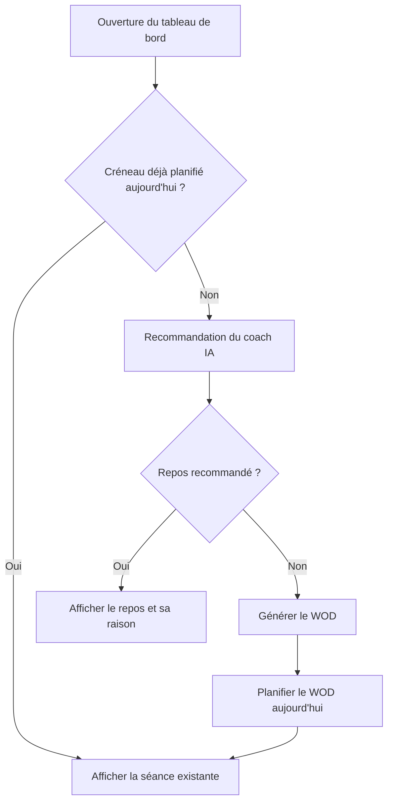

# Séance du jour et coach IA

Ce document explique comment Training Camp décide chaque jour de la séance à faire. Il s'adresse aux Product Owners et aux développeurs qui touchent aux modules `recommendations` et `workouts`.

## Principe

L'athlète n'a rien à construire. Chaque jour, le coach IA :

1. analyse les séances récentes et le diagnostic de performance ;
2. décide s'il faut s'entraîner ou se reposer, et sur quel type de séance ;
3. génère le WOD correspondant et le place dans le calendrier du jour.

L'explication du coach est enregistrée avec la séance. L'athlète voit donc toujours la raison qui a produit **cette** séance.

## Déroulement

Si un créneau existe déjà, qu'il soit planifié à la main ou généré plus tôt, rien n'est généré. En cas d'échec de l'IA, la carte propose de générer une séance manuellement.

## Ce que contient une recommandation

| Champ | Contenu |
|---|---|
| Sport recommandé | `crossfit` ou `rest` (repos) |
| Type de séance | `technique_metcon`, `strength_max`, `conditioning`, `vo2max`, `core` ; repos : `active_recovery` |
| Urgence | Faible, moyenne ou élevée |
| Raison | Pourquoi ce choix aujourd'hui |
| Conseil du coach | Point d'attention pour la séance |
| Durée suggérée | Entier de 20 à 90 minutes (récupération active pour le repos) |
| Focus et consignes | Facultatifs, transmis au générateur de WOD |

Les consignes proposées par le coach IA sont transmises séparément des contraintes
saisies par l'athlète. Ce sont des suggestions : elles ne peuvent remplacer ni les
contraintes de l'athlète, ni la hiérarchie des consignes, ni la structure du type
de séance demandé. Les instructions saisies manuellement restent prioritaires.

## Autres automatismes du même type

Aucun cron serveur n'est utilisé : l'hébergement Render n'est pas toujours actif. Ces tâches se déclenchent donc depuis l'application.

| Automatisme | Déclencheur | Fréquence |
|---|---|---|
| Séance du jour | Affichage de la carte « Séance du jour » | Une fois par jour |
| Bilan mensuel de progression | Connexion | Une fois par mois calendaire |
| Test de benchmark mensuel | Connexion | Un benchmark planifié par mois |

Le benchmark mensuel choisit en priorité un benchmark jamais testé, puis le plus ancien. Il est placé sur le premier jour libre à partir de J+3.

> **Détail technique**
>
> - Endpoint : `POST /api/recommendations/daily-session/check` → `DailySessionService.checkAndGenerateDailySession()`.
> - La recommandation et les résultats des opérations sont persistés dans `daily_coach_operations`, par athlète, journée parisienne et opération (`recommendation`, `session`, `proposal`). Un repos reste identique après redémarrage.
> - Chaque opération autorise trois tentatives au maximum par jour, avec dix minutes d'attente **après un échec**. Un bail distinct de dix minutes protège une exécution en cours ; après un crash, une tentative peut reprendre à son expiration.
> - La réservation SQL atomique exclut les générations concurrentes pour une même clé. Le jeton de réservation est revérifié sous verrou avant toute écriture métier : une ancienne exécution remplacée ne peut pas enregistrer son résultat.
> - Le WOD privé, le créneau (ou la proposition), l'explication et le résultat persistant sont enregistrés dans une même transaction. Une erreur de planification annule le WOD.
> - Google Calendar est synchronisé uniquement après commit, hors transaction, sans bloquer la réponse ; une erreur est journalisée. Cette livraison reste best effort, sans outbox.
> - La recommandation est copiée dans `user_workout_schedule.coach_recommendation`.
> - Côté frontend, `TodaySessionCard` mutualise les appels simultanés (StrictMode) pour éviter deux générations.
> - Côté backend, un conflit de date entre deux appels concurrents renvoie le créneau existant au lieu d'une erreur.
> - Une génération est coûteuse : deux appels OpenAI (recommandation puis WOD).

La limite porte sur les tentatives applicatives, pas sur les requêtes facturées par OpenAI : le client partagé peut réessayer une requête. Un crash ou un timeout après traitement par OpenAI mais avant persistance peut entraîner un nouvel appel ; le fournisseur n'offre pas ici de garantie « exactly once ». Le bail couvre les délais IA par défaut ; si une exécution dépasse dix minutes (configuration différente ou latence), un remplaçant peut travailler en parallèle, mais seul le détenteur du jeton courant peut enregistrer le résultat. Les résultats IA réussis sont figés pour la journée, y compris si l'historique change ensuite. Une tentative échouée peut recommencer le lendemain avec une nouvelle clé ; les anciennes lignes ne sont pas purgées automatiquement.

Le calendrier reste la source de vérité lors de la réutilisation d'un résultat. Une séance générée puis supprimée ou déplacée n'est ni affichée comme séance du jour ni recréée automatiquement ; sans autre créneau aujourd'hui, la carte propose la génération manuelle. Une proposition déjà générée est rattachée sous verrou au créneau de remplacement du jour, sans nouvel appel IA. Si ce créneau a disparu ou est lui-même une séance du coach, la proposition est refusée.
